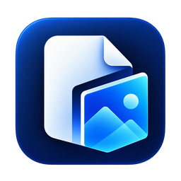
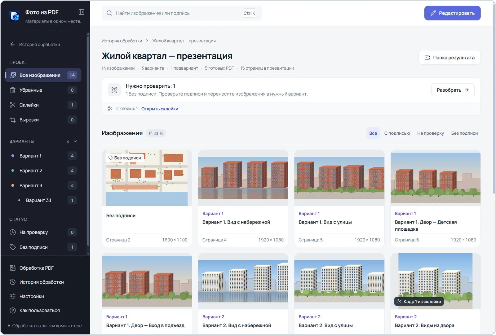
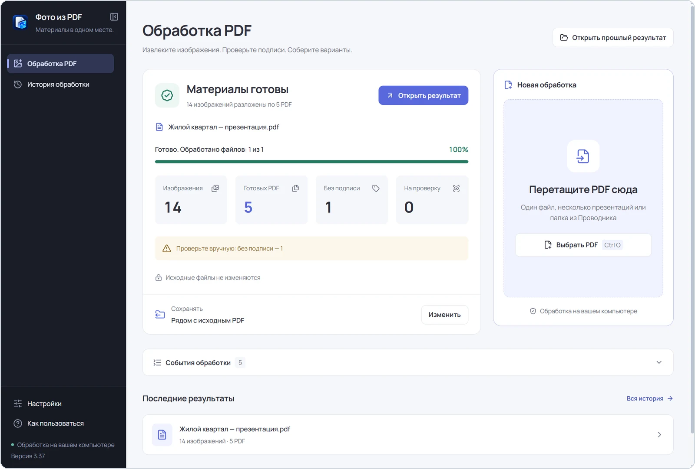
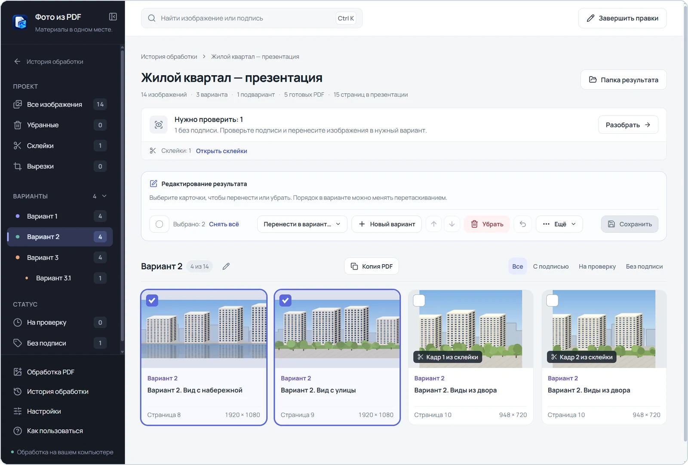
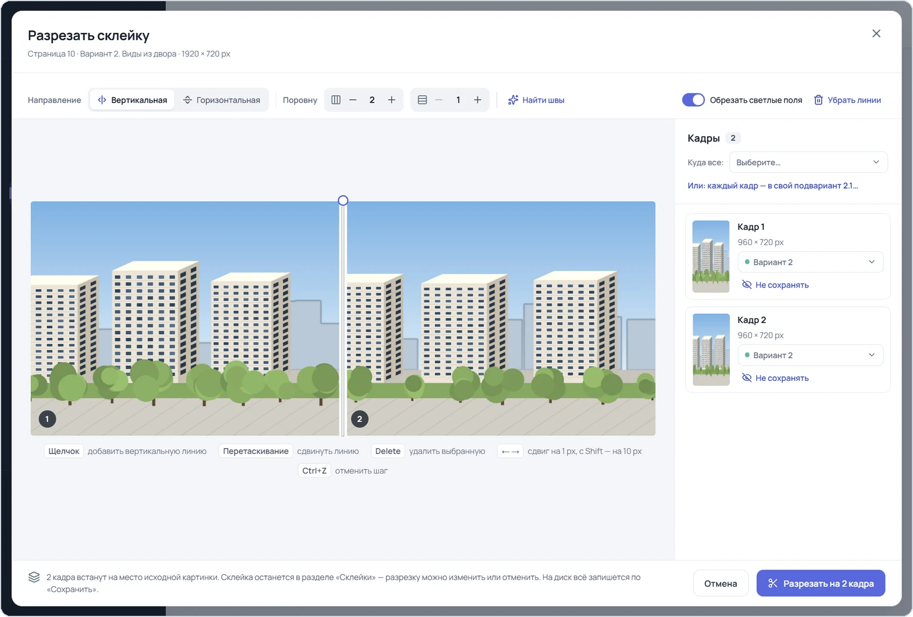
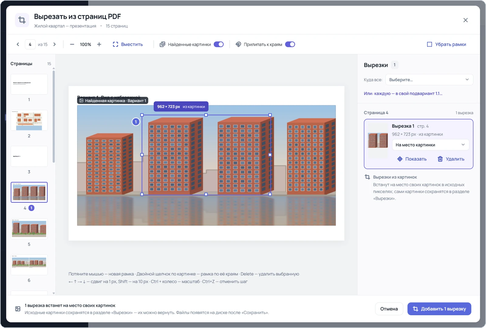

<div align="center">



# Фото из PDF

**Рендеры и фотографии из PDF-презентаций — по подписям и вариантам, один PDF на каждый вариант.**

Программа для Windows. Работает на вашем компьютере: без интернета, аккаунта и подписки.

<a href="https://github.com/richthemat1/Renders-from-PDF/releases/latest/download/PDF-Photos-Setup.exe"></a> &nbsp; <a href="https://github.com/richthemat1/Renders-from-PDF/releases/latest/download/PDF-Photos-Portable.zip"></a>

<sub>Windows 10 и 11 (x64) · <a href="https://github.com/richthemat1/Renders-from-PDF/releases">все выпуски</a> · <a href="CHANGELOG.md">что нового</a></sub>

<br>



</div>

<br>

В презентациях проектов рендеры, планы и схемы перемешаны с текстом, а варианты разнесены по разделам. Вручную приходится находить каждую картинку, вырезать её, решать, к какому варианту она относится, и раскладывать по папкам.

«Фото из PDF» делает это сама: находит изображения, читает подписи рядом с ними, определяет вариант и собирает для каждого варианта многостраничный PDF. Спорное программа не угадывает, а откладывает на проверку — её удобно провести в том же окне.

[Возможности](#возможности) · [Установка](#установка) · [Как пользоваться](#как-пользоваться) · [Что получится](#что-получится) · [Вопросы и ответы](#вопросы-и-ответы)

## Возможности

<table>
<tr>
<td width="50%" valign="top">

<br><br>
<b>Обработка в один шаг</b><br>
Перетащите в окно одну или несколько презентаций — или целую папку. Видны этап, прогресс и итог: сколько изображений найдено и сколько PDF готово. После очереди из нескольких файлов итог перечисляет их все — щелчок открывает нужный результат.
</td>
<td width="50%" valign="top">

<br><br>
<b>Проверка и правка</b><br>
Перенесите изображения в другой вариант, поменяйте порядок, уберите лишнее или создайте новый вариант. Повторяющийся план или плашку можно выделить везде сразу — «Ещё → Выбрать такие же по размеру». Изменения записываются одной кнопкой «Сохранить», последнее сохранение можно отменить.
</td>
</tr>
<tr>
<td width="50%" valign="top">

<br><br>
<b>Склеенные рендеры</b><br>
Картинку, в которой несколько рендеров склеены через светлую полосу или тонкую линию, программа разрезает на отдельные кадры сама. Линии разреза можно поправить, а кадры разложить по вариантам.
</td>
<td width="50%" valign="top">

<br><br>
<b>Вырезки со страниц</b><br>
Если поверх рендера лежит схема или план, обведите нужную часть прямо на странице исходного PDF — в результат попадёт только она, в исходных пикселях.
</td>
</tr>
</table>

- **Подписи и варианты.** Изображение связывается с подписью по тексту и расположению на слайде. Программа понимает страницы разделов «Вариант 1», «Вариант 2» и подварианты вроде «Вариант 3.1».
- **Сканы.** Цельные сканы без текстового слоя распознаются встроенным OCR Windows и делятся на отдельные фотографии.
- **Исходное качество.** Изображения попадают в PDF в исходном разрешении, фотографии JPEG — без повторного сжатия.
- **Без лишнего.** Логотипы, повторяющиеся значки, небольшой план участка в углу слайдов, пустые плашки и мелкие элементы уходят в «Служебные». Если среди них оказалось нужное изображение, его можно вернуть.
- **Исходник не меняется.** Презентация остаётся как есть, а прежние версии файлов результата сохраняются в резервных копиях.
- **История.** Последние 100 результатов открываются в один щелчок, в том числе после перезапуска.
- **Просмотр без программы.** В папке результата есть `Просмотр.html` — его можно открыть в браузере или передать коллегам вместе с папкой.

## Установка

- **[Установщик — `PDF-Photos-Setup.exe`](https://github.com/richthemat1/Renders-from-PDF/releases/latest/download/PDF-Photos-Setup.exe)** — рекомендуется. Ставится для текущего пользователя, без прав администратора. Ярлык появится в меню «Пуск», по желанию — на рабочем столе.
- **[Без установки — `PDF-Photos-Portable.zip`](https://github.com/richthemat1/Renders-from-PDF/releases/latest/download/PDF-Photos-Portable.zip)** — распакуйте ZIP в обычную папку средствами Windows (WinRAR не нужен) и откройте `PDF-Photos.exe`.

Ссылки всегда ведут на последнюю версию. Все выпуски и описания изменений — в разделе [Releases](https://github.com/richthemat1/Renders-from-PDF/releases); архивы `Source code` там — исходники, а не готовая программа.

> [!NOTE]
> Windows может показать окно SmartScreen: у программы пока нет платной цифровой подписи издателя. Убедитесь, что файл скачан с этой страницы, затем нажмите **«Подробнее» → «Выполнить в любом случае»**.

### Что нужно

- **Windows 10 или 11**, 64-разрядная (x64).
- **Microsoft Edge WebView2 Runtime** — обычно уже есть в Windows. Если его нет, установите его с [сайта Microsoft](https://developer.microsoft.com/microsoft-edge/webview2/) (там есть и автономный установщик для компьютера без сети) или откройте ярлык «Совместимый интерфейс» в меню «Пуск»; в переносимой версии — `PDF-Photos.exe --legacy-ui`.
- **Русский пакет распознавания текста (OCR) Windows** — только для сканов. Без него скан сохранится целиком, и программа об этом предупредит.

Python, Node.js, аккаунт и интернет не нужны.

### Обновление

Закройте программу и установите новый установщик поверх прежнего — удалять старую версию не нужно. Результаты, история и настройки сохранятся. Переносимую версию распакуйте в новую папку. Автоматических обновлений пока нет: постоянная ссылка на последнюю версию — **https://github.com/richthemat1/Renders-from-PDF/releases/latest**, её удобно сохранить или отправить коллегам.

## Как пользоваться

1. **Добавьте презентации.** Перетащите PDF — несколько файлов или папку — в окно программы или нажмите «Выбрать PDF» (Ctrl+O). Можно перетащить PDF и на значок программы.
2. **Дождитесь обработки.** Карточка показывает этап и прогресс; «Остановить обработку» прерывает очередь.
3. **Откройте результат.** Изображения, подписи и варианты откроются в этом же окне.
4. **Проверьте спорное.** Кнопка «Разобрать» на панели проверки открывает изображения «На проверку» и «Без подписи» в режиме редактирования.
5. **Поправьте и сохраните.** Перенесите, уберите или переставьте изображения и нажмите «Сохранить». Последнее сохранение можно отменить.

Подробная инструкция со всеми разделами — склейками, вырезками, копиями, историей и настройками — в файле [«Как пользоваться»](Как%20пользоваться.txt).

## Что получится

Рядом с презентацией появится папка с результатом — у каждой презентации своя. Место сохранения можно изменить в настройках: рядом с PDF, в подпапке «Результаты» или в своей папке.

```text
Презентация — PDF/
├── Вариант 1/
│   └── Вариант 1.pdf
├── Вариант 2/
│   └── Вариант 2.pdf
├── Вариант 2.1/
│   └── Вариант 2.1.pdf
├── Все остальное/
│   ├── Без подписи/
│   ├── На проверку/
│   └── папки по другим подписям
├── Просмотр.html
└── Отчёт.json
```

- Одна страница PDF варианта — одно извлечённое изображение; порядок — как в презентации.
- Подвариант («Вариант 2.1») получает собственную папку и PDF.
- Изображения с другими подписями сохраняются отдельными PDF в папках «Все остальное».
- `Отчёт.json` — подробный отчёт обработки; миниатюры и резервные копии лежат в скрытой папке `_Служебное`.

Повторная обработка той же презентации создаёт новую папку; программа заранее предложит открыть прежний результат.

## Вопросы и ответы

<details>
<summary><b>Отправляет ли программа что-нибудь в интернет?</b></summary>
<br>

Нет. Обработка, интерфейс и шрифты работают на компьютере, презентации никуда не передаются. Загрузку файлов в админку программа тоже не выполняет — она готовит материалы локально.

</details>

<details>
<summary><b>Как программа определяет вариант?</b></summary>
<br>

По подписи изображения, заголовку слайда и странице раздела («Вариант 1», «Приложение»). Перспектива без указанного варианта относится к «Варианту 1» — кроме случаев, когда презентация этому противоречит: вариант 1 помечен как предыдущий, первоначальный или отклонённый либо таблица ВПМ выбирает другой вариант. Тогда изображение остаётся «На проверку», и вариант выбирают вручную.

</details>

<details>
<summary><b>Какие изображения не попадут в результат?</b></summary>
<br>

Программа извлекает растровые изображения; чисто векторные иллюстрации отдельно не извлекаются. Повторяющиеся служебные элементы, мелкие значки, пустые светлые плашки и картинки, скрытые под другими, пропускаются — их копии видны в разделе «Служебные», и нужное можно вернуть. Небольшая схема, которая повторяется на четырёх и более слайдах, тоже считается служебной. Крупные схемы и карты могут остаться в результате — лишнее убирается в редакторе, а одинаковые по размеру изображения выделяются разом через «Ещё → Выбрать такие же по размеру».

</details>

<details>
<summary><b>Подпись определилась неверно — что делать?</b></summary>
<br>

Необычная вёрстка и ошибки распознавания сканов иногда сбивают подписи. В крупном просмотре у изображения «На проверку» показаны возможные подписи, переключатель «Исходная страница» показывает слайд целиком, а в режиме редактирования изображение можно сразу перенести в нужный вариант. Для показа исходной страницы презентация должна лежать по прежнему пути.

</details>

<details>
<summary><b>Что будет с картинкой после разрезки или вырезки?</b></summary>
<br>

Исходная картинка сохраняется. Разрезку склейки можно изменить или нажать «Вернуть целиком», вырезку — заменить или нажать «Вернуть картинку». Сложные и неоднозначные коллажи программа сама не режет, а сохраняет целиком с предупреждением.

</details>

<details>
<summary><b>Как применить улучшения новой версии к старому результату?</b></summary>
<br>

Обработайте исходный PDF заново — получится новая папка. Ручные правки прежней выгрузки в неё не переносятся. Возможности редактора — вырезки, копии, подварианты — работают и со старыми результатами, а чтобы нашлись склейки, презентацию нужно обработать заново.

</details>

## Обратная связь

Нашли ошибку или не хватает возможности — [создайте issue](https://github.com/richthemat1/Renders-from-PDF/issues/new). Укажите версию программы, что вы делали и текст ошибки. Технический журнал открывается ссылкой в окне программы.

<br>

<div align="center">
<sub>Автор — <a href="https://github.com/richthemat1">richthemat1</a> · <a href="CHANGELOG.md">Что нового</a> · <a href="Лицензии%20компонентов.txt">Лицензии компонентов</a></sub>
</div>
